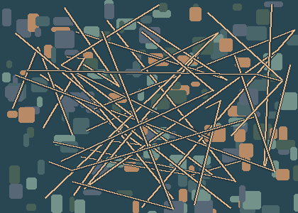

# GTA VI Screenshot Locator

**Where on the map was this screenshot taken?** Crop its minimap, compare it with a reference atlas and inspect the three strongest distinct matches.

| Query crop | Reference atlas |
|---|---|
|  |  |

## Find the example crop

```sh
python -m pip install -r requirements.txt
python locate.py demo/atlas.png demo/query.png
```

The first candidate should be **(126, 117)**, the centre of the matching patch in atlas pixels. The output includes a correlation score for each candidate. Inspect the runners-up when two areas have similar textures.

## Try a difficult match

Use a north-up crop and an atlas at the same zoom. Compare a distinctive junction with a patch containing mostly a straight road. Repeated textures can put several candidates close together. This method matches map pixels and requires a minimap crop.

To apply the same idea over time, try [Route Replay](https://github.com/Berserk-hub150/gta6-route-replay).

---

[Explore the GTA VI project collection](https://github.com/Berserk-hub150/gta6-resource-index) · Independent fan project. Grand Theft Auto is a trademark of its respective owners.
